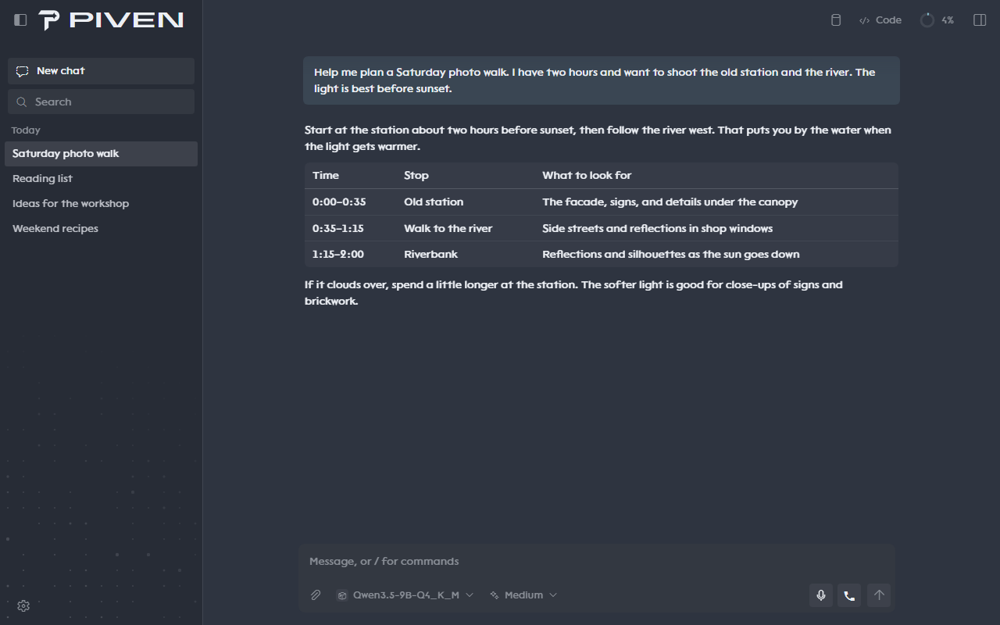

<picture>
  <source media="(prefers-color-scheme: dark)" srcset="docs/images/logo-dark.svg">
  
</picture>

# PIVEN Companion

AI chat and coding on your own Windows PC.

[Download for Windows](https://github.com/covriknapoly-glitch/piven-companion/releases/latest)

I wanted something like OpenCode that felt at home on my Windows desktop. I wanted to open it, pick a model, and get back to whatever I was building. So I made PIVEN Companion.

## Give it a project

Turn on **Code**, pick a folder, and try asking, “Where does this app save its settings?” PIVEN can look through the project to find out. If you ask it to change something, you can see which files it touched and what happened when it ran the tests. Open **Files → Project** if you want to read a file yourself or drop its path into the chat.

When you come back to the same folder in a new chat, PIVEN can reuse its project notes. It also looks for a guide in `AGENTS.md`, `CLAUDE.md`, or `README.md`. You can see the notes under **Files → Project memory**, remove them, or refresh the document index after editing files outside PIVEN.

## You can just talk to it, too

There’s a mic in the chat box for dictation and a phone button for a call. Speech recognition and the voice that reads replies can use different models or services. If you get halfway through a chat and want to try a different idea, branch from an earlier message and take it from there.

You can give PIVEN a folder full of documents and click a citation to see where an answer came from. Facts it remembers between chats show up in **Settings → Memory**, where you can delete them. It can also look things up, open programs, make a presentation, or generate pictures and video through ComfyUI or a connected provider.

<table>
<tr>
<td width="50%"> Coding mode</td>
<td width="50%"> Model settings</td>
</tr>
<tr>
<td> Voice settings</td>
<td> Appearance</td>
</tr>
</table>

## Install it

Grab `PIVEN-Companion-<version>-Setup.exe` under **Assets** and run it on Windows 10 or 11. The app is available in English and Russian. [Latest release](https://github.com/covriknapoly-glitch/piven-companion/releases/latest)

If you’re starting from scratch, try the model PIVEN suggests. You can also look for a compatible GGUF on Hugging Face inside the app. PIVEN shows roughly how much memory each model needs and how fast it might run on your PC. The files can be several gigabytes each, so check the size before you hit download. An NVIDIA GPU helps with speed, and you can run models on the CPU too.

## Connect a model you already use

Already running Ollama or LM Studio? Open **Settings → Integrations**, connect your server, and its models will show up in the chat picker. The same menu has OpenRouter, Google, OpenAI, and Anthropic if you have an API key. You can set a different system prompt for each chat model.

vLLM, Strata, and Unsloth Studio

- **vLLM** defaults to `http://127.0.0.1:8000/v1`. For tool calls, start the server with `--enable-auto-tool-choice` and the `--tool-call-parser` for your model. [vLLM tool calling](https://docs.vllm.ai/en/stable/features/tool_calling/)
- **Strata** defaults to `http://127.0.0.1:8080/v1`. Load a chat model in Strata first. [Strata setup](https://github.com/Niko1221/Strata/blob/main/docs/INSTALL.md)
- **Unsloth Studio** defaults to `http://127.0.0.1:8888/v1`. Load a chat model in Studio, then copy the key from **Settings → API**. If you change the loaded model, click **Reconnect** in PIVEN. [Unsloth Studio API](https://unsloth.ai/docs/basics/api)

## Your data

Your chats, settings, and models live in `%LOCALAPPDATA%\PIVEN`. A request to a cloud model can include your message and relevant excerpts from your files. Cloud speech services receive the audio to transcribe or the text to read out loud. If you share your screen in a call with a cloud model, the request can include screenshots too.

## Run from source

1. Put Python 3.11 in `runtime\Python311`.
2. Run `runtime\Python311\python.exe -m pip install --target .packages -r requirements.txt`.
3. Put the Windows llama.cpp binaries in `llama.cpp\bin`.
4. Run `Запустить PIVEN.cmd`.

If you change the interface, run `npm install` in `ui` once and then `ui\scripts\build.cmd`.

## License

PIVEN is free and open source under the [GNU GPL v3 or later](LICENSE). Models, voices, and services have their own terms. See the [terms of use](TERMS.txt) and [third-party notices](docs/THIRD_PARTY_NOTICES.md).
