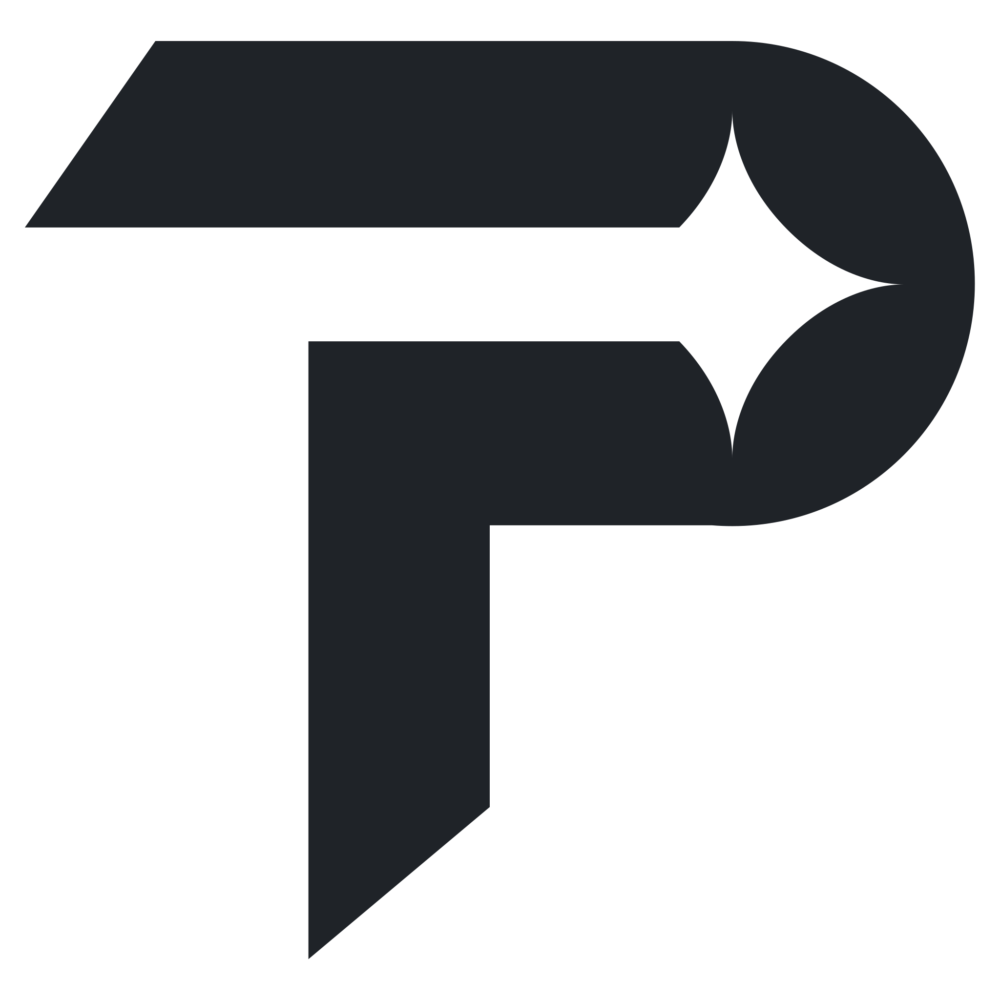
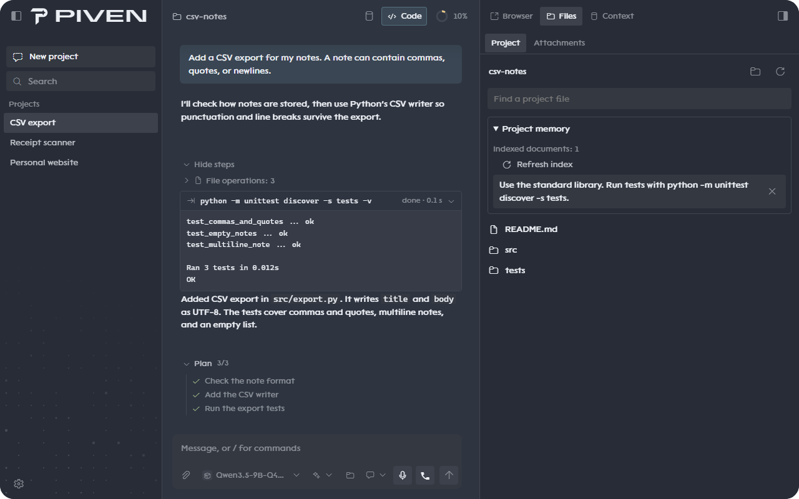
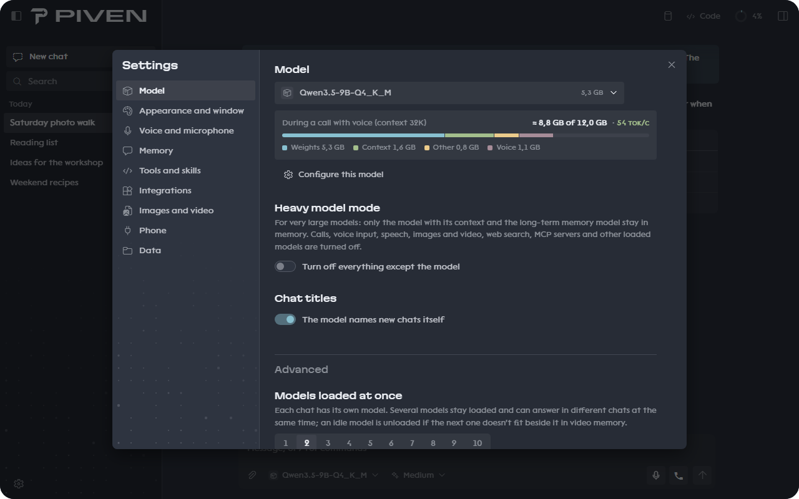
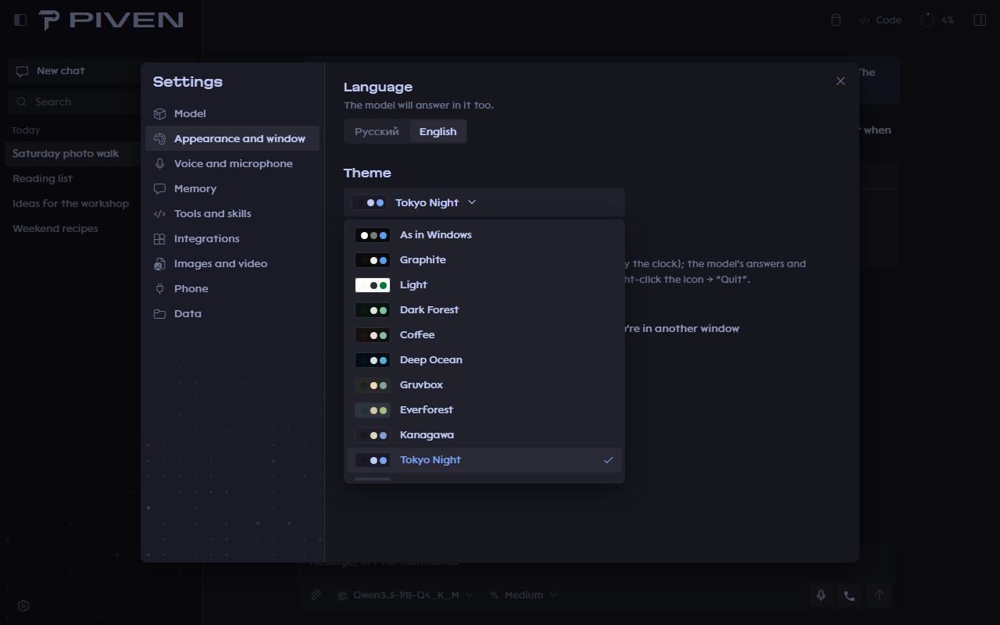

<picture>
  <source media="(prefers-color-scheme: dark)" srcset="docs/images/logo-dark.svg">
  
</picture>

# PIVEN Companion

A Windows app for running AI models on your own PC.

[Download for Windows](https://github.com/covriknapoly-glitch/piven-companion/releases/latest)

Open PIVEN, pick a model, and start chatting. You can type, dictate a message, or have a voice call. For coding, give it a project folder so it can work with the actual files. You can run a model on your PC or connect a service you already use.

## Getting started

1. Open the [latest release](https://github.com/covriknapoly-glitch/piven-companion/releases/latest) and download `PIVEN-Companion-<version>-Setup.exe` under **Assets**.
2. Run the installer on Windows 10 or 11, then open PIVEN.
3. Try the suggested model, look for another compatible GGUF on Hugging Face, or connect a provider under **Settings → Integrations**.

PIVEN estimates memory use and speed before you download a local model. Leave room for the weights, which can take several gigabytes per model. An NVIDIA GPU can speed up local generation. You can also run models on the CPU. The interface is available in English and Russian.

## What you can do

- **Work on a codebase.** Turn on **Code** and choose a folder. Ask PIVEN to explain a file, make a change, or run the tests. **Files → Project** lets you browse the folder, preview text files, and insert paths into your message.
- **Keep useful context.** Add a folder of documents to the knowledge base and open the passages cited in an answer. You can see and delete facts saved between chats. To try a different direction, start a branch from an earlier message.
- **Talk to a model.** Dictate a message or start a call from the chat box. Choose local models or connected cloud services separately for recognizing speech and reading answers aloud.
- **Make things in chat.** Ask PIVEN to search the web, open a program, or create a file such as a presentation. With ComfyUI or a compatible cloud provider connected, you can also generate images and video.

<table>
<tr>
<td width="50%"> Coding mode</td>
<td width="50%"> Model settings</td>
</tr>
<tr>
<td> Voice settings</td>
<td> Appearance</td>
</tr>
</table>

### When you come back to a project

PIVEN reads the file tree and looks for a project guide in `AGENTS.md`, `CLAUDE.md`, or `README.md`. It can look up project docs and save notes for future chats in that folder. Open **Project memory** under **Files** to see or remove those notes, or refresh the index after editing docs outside PIVEN.

## Connect a model you already use

Open **Settings → Integrations** to connect a local server such as Ollama, LM Studio, vLLM, Strata, or Unsloth Studio, or a cloud provider such as OpenRouter, Google, OpenAI, or Anthropic. Enter the server address or API key as needed. Once connected, choose a chat model from the picker under the message box. Each chat model can have its own system prompt.

- **vLLM** defaults to `http://127.0.0.1:8000/v1`. For tool calls, start the server with `--enable-auto-tool-choice` and the `--tool-call-parser` for your model. [vLLM tool calling](https://docs.vllm.ai/en/stable/features/tool_calling/)
- **Strata** defaults to `http://127.0.0.1:8080/v1`. Load a chat model in Strata first. [Strata setup](https://github.com/Niko1221/Strata/blob/main/docs/INSTALL.md)
- **Unsloth Studio** defaults to `http://127.0.0.1:8888/v1`. Load a chat model in Studio, then copy the key from **Settings → API**. If you change the loaded model, click **Reconnect** in PIVEN. [Unsloth Studio API](https://unsloth.ai/docs/basics/api)

## Your data

PIVEN stores chats, settings, and models on your PC in `%LOCALAPPDATA%\PIVEN`. When you use a cloud service, PIVEN sends it the data needed for that task. This can include chat messages and relevant excerpts from attached files or project docs, recorded speech for transcription, or text to read aloud. If you share your screen during a call with a cloud model, screenshots can be included too.

## Run from source

1. Put Python 3.11 in `runtime\Python311`.
2. Run `runtime\Python311\python.exe -m pip install --target .packages -r requirements.txt`.
3. Put the Windows llama.cpp binaries in `llama.cpp\bin`.
4. Run `Запустить PIVEN.cmd`.

If you change the interface, run `npm install` in `ui` once and then `ui\scripts\build.cmd`.

## License

PIVEN is free and open source under the [GNU GPL v3 or later](LICENSE). Models, voices, and services have their own terms. See the [terms of use](TERMS.txt) and [third-party notices](docs/THIRD_PARTY_NOTICES.md).
