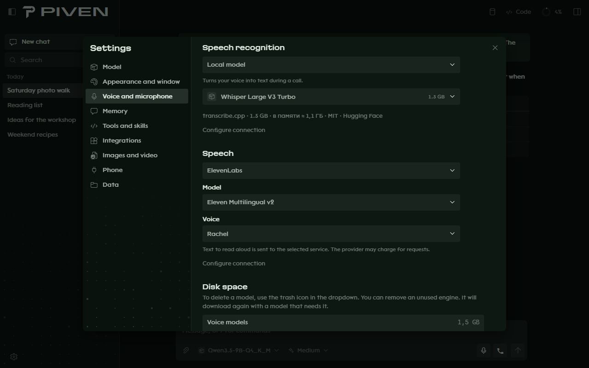

<picture>
  <source media="(prefers-color-scheme: dark)" srcset="docs/images/logo-dark.svg">
  
</picture>

# PIVEN Companion

An AI agent for Windows that runs on your own PC.

[Download for Windows](https://github.com/covriknapoly-glitch/piven-companion/releases/latest)

I wanted an AI agent like OpenCode that was easy to use on my Windows PC. So I made one.

## Coding

Turn on **Code** and pick your project folder. You can ask it something like “Where does this app save its settings?” or ask it to fix a bug. It can read and change files and run tests. You can see what it did in the chat. Open **Files → Project** to see the files or add a file path to your message.

PIVEN looks for `AGENTS.md`, `CLAUDE.md`, or `README.md` in the project. It can save notes and use them again when you open the same folder in a new chat. You can see or delete the notes in **Project memory** under **Files**. You can also refresh the list of docs it can search there.

## Chat and voice

You can type, use the mic, or just call it and talk. You can pick one model for speech recognition and another one to read the answers out loud. If you want to try a different idea, you can start a new branch from an earlier message.

You can give it a folder of docs and open the part it used in an answer. It can also remember things between chats. You can see what it saved and delete it in **Settings → Memory**.

It can search the web, open programs, and make presentations. For pictures and video, you can use ComfyUI or a cloud service you connect.

<table>
<tr>
<td width="50%"> Coding mode</td>
<td width="50%"> Model settings</td>
</tr>
<tr>
<td> Voice settings</td>
<td> Appearance</td>
</tr>
</table>

## Install it

Download `PIVEN-Companion-<version>-Setup.exe` under **Assets** and run it. It works on Windows 10 and 11. The app is in English and Russian. [Latest release](https://github.com/covriknapoly-glitch/piven-companion/releases/latest)

Try the model the app suggests when you open it. You can also find and download other compatible GGUF models from Hugging Face in the app. Before you download one, PIVEN shows how much memory it might need and how fast it might run. Models can take up a few GB each. An NVIDIA GPU helps with speed. You can run models on the CPU too.

## Connect a model you already use

If you already use Ollama or LM Studio, you can connect it in **Settings → Integrations**. Its models will show up in the chat picker. You can also use your own API key for OpenRouter, Google, OpenAI, or Anthropic. Each chat model can have its own system prompt.

vLLM, Strata, and Unsloth Studio

- **vLLM** defaults to `http://127.0.0.1:8000/v1`. For tool calls, start the server with `--enable-auto-tool-choice` and the `--tool-call-parser` for your model. [vLLM tool calling](https://docs.vllm.ai/en/stable/features/tool_calling/)
- **Strata** defaults to `http://127.0.0.1:8080/v1`. Load a chat model in Strata first. [Strata setup](https://github.com/Niko1221/Strata/blob/main/docs/INSTALL.md)
- **Unsloth Studio** defaults to `http://127.0.0.1:8888/v1`. Load a chat model in Studio, then copy the key from **Settings → API**. If you change the loaded model, click **Reconnect** in PIVEN. [Unsloth Studio API](https://unsloth.ai/docs/basics/api)

## Your data

Your chats, settings, and models are saved in `%LOCALAPPDATA%\PIVEN`. When you use a cloud model, it gets your message and can get parts of your files. A cloud speech service gets the audio you want to turn into text or the text you want read out loud. If you turn on screen sharing in a call with a cloud model, it can get screenshots too.

## Run from source

1. Put Python 3.11 in `runtime\Python311`.
2. Run `runtime\Python311\python.exe -m pip install --target .packages -r requirements.txt`.
3. Put the Windows llama.cpp binaries in `llama.cpp\bin`.
4. Run `Запустить PIVEN.cmd`.

If you change the interface, run `npm install` in `ui` once and then `ui\scripts\build.cmd`.

## License

PIVEN is free and open source under the [GNU GPL v3 or later](LICENSE). Models, voices, and services have their own terms. See the [terms of use](TERMS.txt) and [third-party notices](docs/THIRD_PARTY_NOTICES.md).
