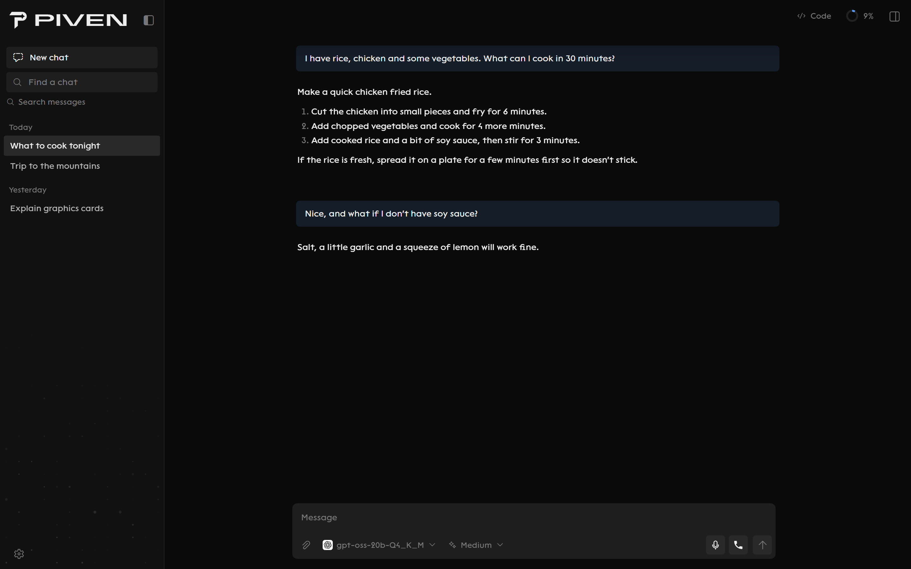
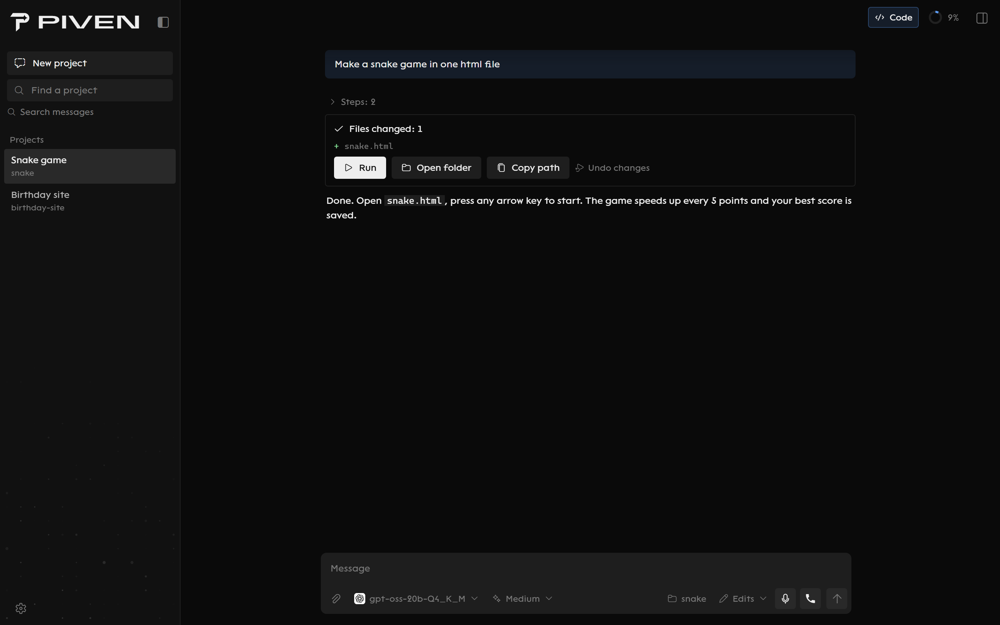
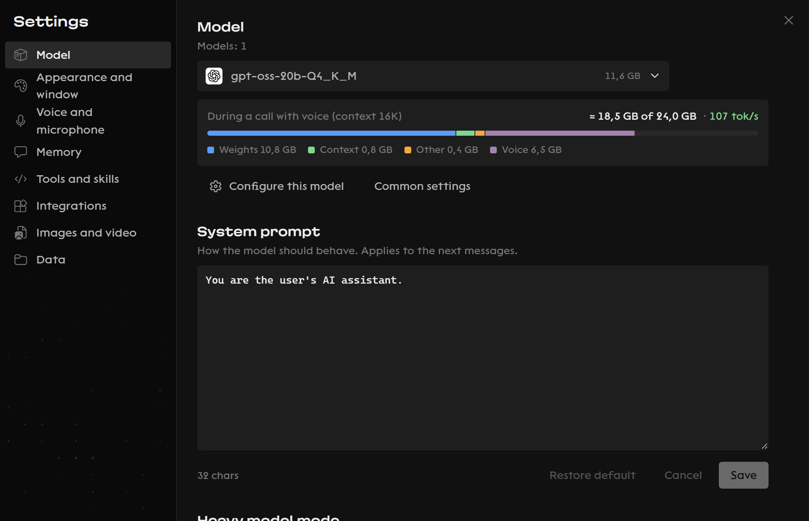
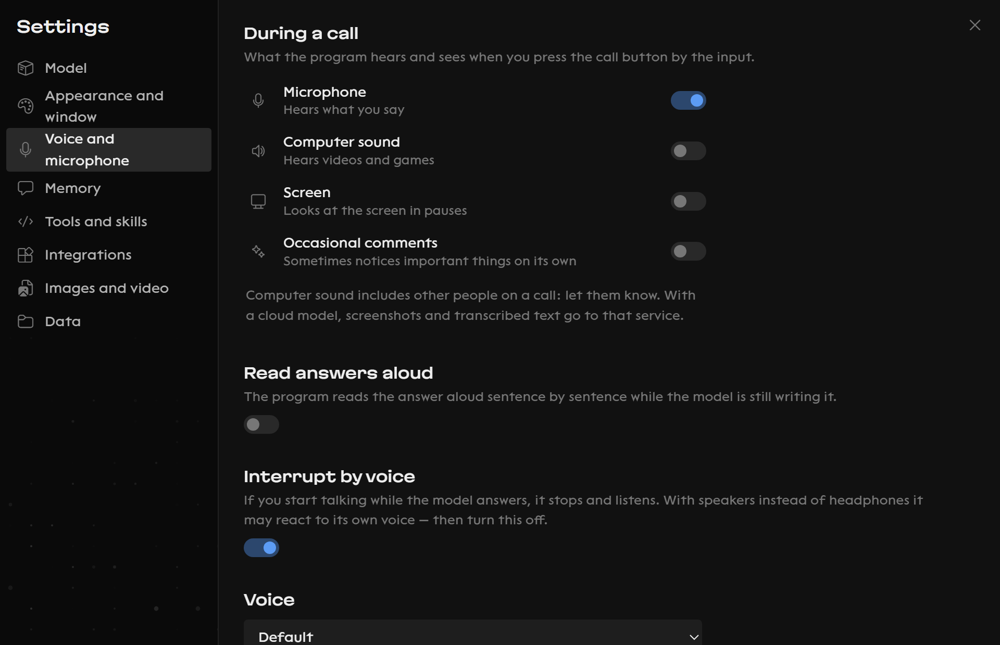
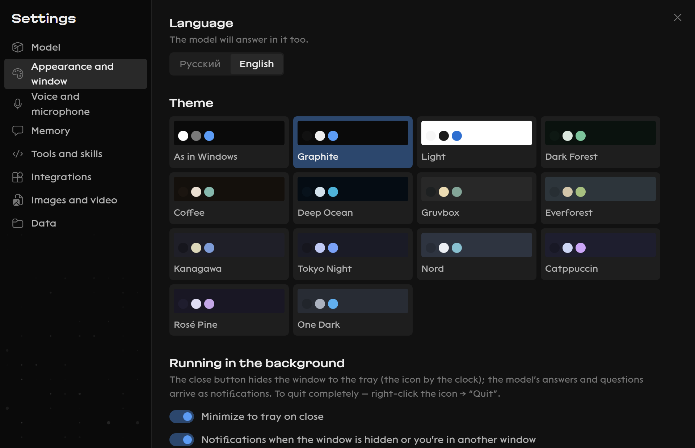

<picture>
  <source media="(prefers-color-scheme: dark)" srcset="docs/images/logo-dark.svg">
  
</picture>

# PIVEN Companion

AI chat for Windows that runs on your own PC.

## What is this

I wanted an AI chat that works without internet and keeps my stuff on my PC, so I made one.

You download a model right in the app and talk to it. Before downloading it tells you if the model will fit and how fast it will be.

## What it can do

- Chat by text or voice. You can also just call it and talk.
- Search the internet, open programs and make files.
- Write programs for you. It works in its own folder and you can undo what it did.
- Make presentations.
- Draw pictures and short videos if you have ComfyUI.
- Remember stuff between chats. You can see and delete everything it remembers.
- Work with Ollama, LM Studio, OpenAI, Claude, Gemini and OpenRouter if you want.

English and Russian. Light and dark themes.

<table>
<tr>
<td width="50%"> Writes programs</td>
<td width="50%"> Shows if a model fits</td>
</tr>
<tr>
<td> Voice and calls</td>
<td> Themes</td>
</tr>
</table>

## How to install

1. Download `PIVEN-Companion-<version>-Setup.exe` from [Releases](https://github.com/covriknapoly-glitch/piven-companion/releases).
2. Run it.
3. Open PIVEN Companion from the Start menu.

You need:

- Windows 10 or 11
- An NVIDIA card is best. Without one it still works but slower.
- About 1.2 GB for the app and more for models (usually 2 to 20 GB each)

When you open it, it suggests a model for your PC. Download it and say hi.

## Your data

- Everything stays on your PC in `%LOCALAPPDATA%\PIVEN`.
- Nothing downloads unless you say so.
- If you use a cloud model, your messages go to that service. On a call that includes screenshots and what it hears, so tell people if you're on a call with them.
- Only copy your own voice or the voice of someone who said it's ok.
- Pictures and videos made in the app have a hidden mark that says AI made them.

## If you want to build it

1. Put Python 3.11 in `runtime\Python311`.
2. Run `runtime\Python311\python.exe -m pip install --target .packages -r requirements.txt`
3. Put llama.cpp in `llama.cpp\bin`.
4. Run `Запустить PIVEN.cmd`.

If you change the interface, run `npm install` in `ui` once and then `ui\scripts\build.cmd`.

## Rules

You pick the models, voices and services, and what you do with them is on you. I don't make them and I'm not connected to them. See [TERMS.txt](TERMS.txt).

## License

GPL v3 or later. It's free. If you share a changed version it has to stay open too. Other people's stuff and its licenses are in [docs/THIRD_PARTY_NOTICES.md](docs/THIRD_PARTY_NOTICES.md).
